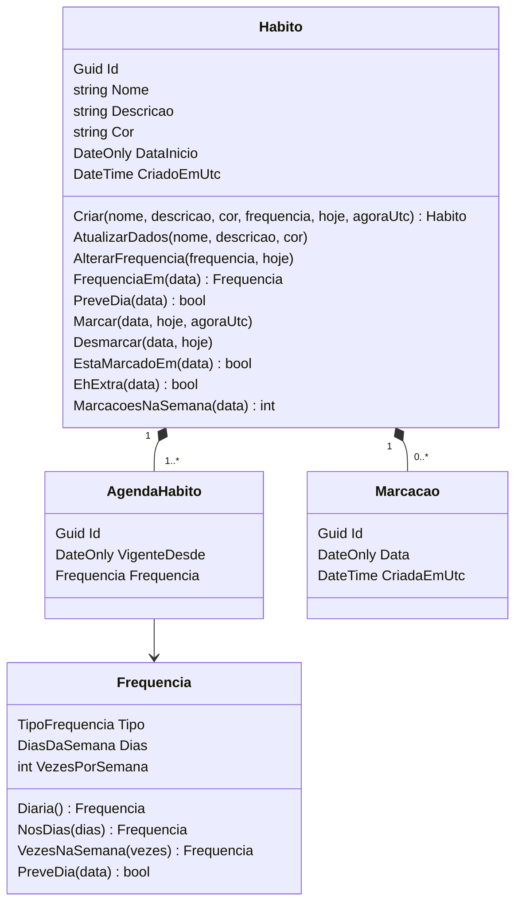
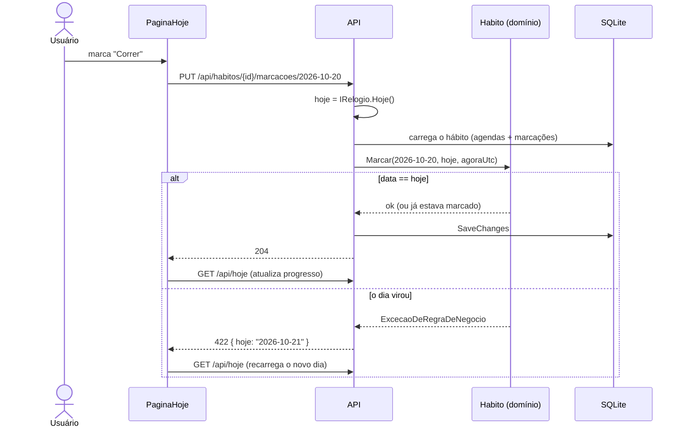

# Spec 001 — Design

> **Status:** Aprovada
> **Requisitos:** [requisitos.md](requisitos.md)

## 1. Visão geral

- Back-end ASP.NET Core Minimal API com domínio rico (`Habito` como agregado) e EF Core + SQLite.
- Front-end Angular com duas áreas nesta spec: **Hoje** e **Hábitos** (lista + formulário).
- "Hoje" é sempre decidido no servidor (D18). Ao marcar, o cliente envia a data que acredita ser hoje e o servidor recusa se ela divergir. É assim que detectamos a virada do dia (6.6).

## 2. Domínio



### Tipos

```csharp
public enum TipoFrequencia { Diaria = 1, DiasDaSemana = 2, VezesPorSemana = 3 }

[Flags]
public enum DiasDaSemana
{
    Nenhum = 0, Segunda = 1, Terca = 2, Quarta = 4, Quinta = 8, Sexta = 16, Sabado = 32, Domingo = 64
}
```

### Regras

**`Frequencia`** (objeto de valor, imutável)

- `Diaria()`; `NosDias(dias)` exige `dias != Nenhum` (1.7); `VezesNaSemana(n)` exige 1 ≤ n ≤ 6 (1.8).
- `PreveDia(data)`: diária e vezes por semana → sempre `true`; dias da semana → o dia da semana de `data` está em `Dias` (5.2).

**`Habito`** (agregado: toda alteração passa por ele)

- `Criar`: remove espaços das pontas do nome; valida nome (1 a 60), descrição (até 200) e cor (pertence a `PaletaDeCores`); define `DataInicio = hoje` e cria a primeira agenda com `VigenteDesde = hoje` (1.1 a 1.6).
- `AtualizarDados`: mesmas validações de nome, descrição e cor; não toca agendas nem marcações (3.1, 3.2).
- `AlterarFrequencia(nova, hoje)` (3.3, 3.4):
  1. Se `FrequenciaEm(hoje) == nova`, não faz nada.
  2. Se já existe agenda com `VigenteDesde == hoje`, substitui a frequência dela. Se ela ficar igual à da agenda anterior, remove a agenda de hoje.
  3. Senão, adiciona uma agenda com `VigenteDesde = hoje`.
- `FrequenciaEm(data)`: frequência da agenda com o maior `VigenteDesde ≤ data`.
- `Marcar(data, hoje, agoraUtc)`: se `data != hoje`, lança `ExcecaoDeRegraDeNegocio("Só é possível marcar o dia de hoje")` (6.4); se já está marcado, não faz nada (6.3); senão adiciona a `Marcacao` (6.1, 6.5).
- `Desmarcar(data, hoje)`: mesma checagem de data; remove a marcação se existir (6.2, 6.3).
- `EhExtra(data)`: `EstaMarcadoEm(data) && !PreveDia(data)`. **Não é gravado** (D22), por isso o critério 3.5 funciona sem código extra.
- `MarcacoesNaSemana(data)`: quantidade de marcações entre `Semana.InicioDe(data)` e os 6 dias seguintes (5.5).

**Outros**

- `Semana.InicioDe(data)`: segunda-feira da semana de `data` (7.2).
- `PaletaDeCores.Todas`: `#E53935`, `#FB8C00`, `#FDD835`, `#43A047`, `#00ACC1`, `#1E88E5`, `#8E24AA`, `#6D4C41` (1.5).
- Exceções: `ExcecaoDeValidacao(campo, mensagem)` e `ExcecaoDeRegraDeNegocio(mensagem)`.
- O nome repetido (1.3) exige consulta ao banco: é verificado no endpoint (seção 4) e garantido por índice único (seção 3).

## 3. Persistência (EF Core + SQLite)

| Tabela | Colunas | Restrições |
|---|---|---|
| `Habitos` | `Id`, `Nome` (60), `NomeNormalizado` (60), `Descricao` (200, opcional), `Cor` (7), `DataInicio`, `CriadoEmUtc` | PK `Id`; único `NomeNormalizado` |
| `AgendasHabito` | `Id`, `HabitoId`, `Tipo`, `Dias`, `VezesPorSemana` (opcional), `VigenteDesde` | FK `HabitoId` com cascata; único (`HabitoId`, `VigenteDesde`) |
| `Marcacoes` | `Id`, `HabitoId`, `Data`, `CriadaEmUtc` | FK `HabitoId` com cascata; único (`HabitoId`, `Data`) |

- `NomeNormalizado = Nome.ToUpperInvariant()`. O `NOCASE` do SQLite não trata acentos ("Água" × "água"), então normalizamos no código (1.3).
- `Frequencia` é mapeada como *complex type* do EF Core dentro de `AgendaHabito` (colunas `Tipo`, `Dias`, `VezesPorSemana`).
- Datas de negócio (`DataInicio`, `VigenteDesde`, `Data`) são `DateOnly`; enums são gravados como inteiro; `Dias` é um inteiro com flags.
- A cascata nas FKs garante o critério 4.2.
- A lista é ordenada por `CriadoEmUtc` (2.1).
- O agregado é carregado inteiro (`Include` de agendas e marcações). Com o volume esperado (dezenas de hábitos, milhares de marcações), isso é aceitável.
- Connection string `Data Source=habitos.db`; migrations aplicadas na inicialização em ambiente de desenvolvimento.

## 4. API

Base `/api`. JSON em camelCase, enums como texto.

| Método e rota | Descrição | Respostas | Requisitos |
|---|---|---|---|
| `GET /api/hoje` | Data de hoje e hábitos separados em `paraHoje` e `extras` | 200 | 5.1–5.8, 7.1 |
| `GET /api/habitos` | Lista em ordem de criação | 200 | 2.1 |
| `GET /api/habitos/{id}` | Um hábito (para o formulário de edição) | 200, 404 | 3.6 |
| `POST /api/habitos` | Cadastra | 201 + `Location`, 400 | 1.1–1.9 |
| `PUT /api/habitos/{id}` | Atualiza dados e frequência | 204, 400, 404 | 3.1–3.5 |
| `DELETE /api/habitos/{id}` | Exclui o hábito e todo o histórico | 204, 404 | 4.2 |
| `PUT /api/habitos/{id}/marcacoes/{data}` | Marca o dia (`data` no formato AAAA-MM-DD) | 204, 404, 422 | 6.1, 6.3–6.6 |
| `DELETE /api/habitos/{id}/marcacoes/{data}` | Desmarca o dia | 204, 404, 422 | 6.2–6.4, 6.6 |

`PUT` e `DELETE` são idempotentes por definição, o que atende ao critério 6.3.

**Organização no projeto `Habitos.Api`:** `Endpoints/` (um arquivo por grupo: `HabitosEndpoints`, `HojeEndpoints`, `MarcacoesEndpoints`), `Contratos/` (records de requisição e resposta), `Erros/` (`IExceptionHandler`) e `Relogio.cs`.

### Contratos

**Cadastro e edição** (`POST /api/habitos` e `PUT /api/habitos/{id}`)

```json
{
  "nome": "Academia",
  "descricao": "Treino de força",
  "cor": "#43A047",
  "frequencia": { "tipo": "diasDaSemana", "dias": ["segunda", "quarta", "sexta"], "vezesPorSemana": null }
}
```

- `tipo`: `diaria` | `diasDaSemana` | `vezesPorSemana`
- `dias`: `segunda`, `terca`, `quarta`, `quinta`, `sexta`, `sabado`, `domingo` (usado só em `diasDaSemana`)
- `vezesPorSemana`: 1 a 6 (usado só em `vezesPorSemana`)

**Hábito** (`GET /api/habitos` e `GET /api/habitos/{id}`). O campo `frequencia` é sempre a vigente hoje.

```json
{
  "id": "0192f0c1-7b3e-7c2a-9d41-2f6a1b8e4c10",
  "nome": "Academia",
  "descricao": "Treino de força",
  "cor": "#43A047",
  "dataInicio": "2026-10-20",
  "frequencia": { "tipo": "diasDaSemana", "dias": ["segunda", "quarta", "sexta"], "vezesPorSemana": null }
}
```

**Hoje** (`GET /api/hoje`), numa terça-feira

```json
{
  "data": "2026-10-20",
  "paraHoje": [
    {
      "id": "…", "nome": "Correr", "cor": "#E53935",
      "frequencia": { "tipo": "vezesPorSemana", "dias": [], "vezesPorSemana": 3 },
      "marcadoHoje": false,
      "progressoSemana": { "marcacoes": 1, "meta": 3, "metaAtingida": false }
    }
  ],
  "extras": [
    {
      "id": "…", "nome": "Academia", "cor": "#43A047",
      "frequencia": { "tipo": "diasDaSemana", "dias": ["segunda", "quarta", "sexta"], "vezesPorSemana": null },
      "marcadoHoje": false,
      "progressoSemana": null
    }
  ]
}
```

**Erro 400 — dados inválidos**

```json
{ "title": "Dados inválidos", "status": 400, "errors": { "nome": ["Já existe um hábito com esse nome."] } }
```

**Erro 422 — marcação fora de hoje.** A extensão `hoje` permite ao front-end recarregar o dia certo (6.6).

```json
{ "title": "Só é possível marcar o dia de hoje", "status": 422, "hoje": "2026-10-21" }
```

### "Hoje" no servidor

```csharp
public interface IRelogio
{
    DateOnly Hoje();      // data atual no fuso configurado
    DateTime AgoraUtc();
}
```

A implementação `Relogio` usa `TimeProvider` e `TimeZoneInfo.FindSystemTimeZoneById(config["Aplicacao:FusoHorario"])`. Nos testes, `FakeTimeProvider` controla o instante. Exemplo para o critério 7.1: o instante `2026-10-21T02:30Z` corresponde a hoje = `2026-10-20` em São Paulo (UTC−3).

## 5. Front-end

### Rotas

| Rota | Tela | Requisitos |
|---|---|---|
| `/` | redireciona para `/hoje` | 5.1 |
| `/hoje` | `PaginaHoje` | 5, 6 |
| `/habitos` | `ListaHabitos` | 2, 4 |
| `/habitos/novo` | `FormularioHabito` (cadastro) | 1 |
| `/habitos/:id/editar` | `FormularioHabito` (edição) | 3 |

### Componentes e serviços

- **Shell (layout):** barra superior com o nome do app e navegação "Hoje" / "Hábitos"; em telas estreitas, a navegação vira menu.
- **`PaginaHoje`:** chama `GET /api/hoje`; mostra a data por extenso (pipe `date` com locale `pt-BR`, a partir da `data` devolvida pela API); seções "Para hoje" e "Extras" (esta só aparece se tiver itens); estado vazio.
- **`ItemHabitoHoje`:** controle de marcação, cor, nome e progresso semanal ("2 de 3 nesta semana" ou "Meta da semana atingida").
  - Ao alternar, chama `PUT` ou `DELETE` com a `data` recebida da API. O controle fica desabilitado durante a requisição, o que evita o duplo clique.
  - Em caso de sucesso, recarrega `GET /api/hoje` para obter o progresso atualizado. É simples e não duplica regras no front-end.
  - Em caso de 422, mostra o snackbar "O dia mudou. Atualizando…" e recarrega `GET /api/hoje` (6.6).
  - Em outros erros, mantém o estado anterior e mostra mensagem (6.7).
- **`ListaHabitos`:** cor, nome, resumo da frequência, ações de editar e excluir; estado vazio com o botão "Criar primeiro hábito".
- **`DialogoConfirmacao`** (compartilhado): `MatDialog` genérico com título, mensagem e botões; usado na exclusão (4.1).
- **`FormularioHabito`:** formulário reativo tipado com seletor de cor (8 amostras com rótulo acessível), seletor de tipo de frequência (`mat-button-toggle`) e, conforme o tipo, a escolha dos dias da semana ou o campo numérico da meta. As validações no cliente espelham as do servidor, e os erros 400 do servidor são aplicados ao campo correspondente (1.9).
- **Pipe `resumoFrequencia`:** "Todos os dias" · "Seg, Qua, Sex" (sempre na ordem de segunda a domingo) · "1 vez por semana" / "3 vezes por semana".
- **`HabitosApiService`** (`nucleo/api`): um método tipado por endpoint.
- **Interceptor de erros:** erros de rede e 5xx viram um snackbar genérico; 400, 404 e 422 são repassados para a tela tratar.
- Locale `pt-BR` registrado globalmente.

## 6. Fluxo: marcar um hábito



## 7. Tratamento de erros

| Situação | Status | Comportamento no front-end |
|---|---|---|
| Validação de domínio ou nome repetido | 400 | Erros exibidos nos campos do formulário |
| Hábito inexistente | 404 | Snackbar "Hábito não encontrado" e volta para a lista |
| Marcação fora de hoje | 422 | Snackbar e recarga da tela "Hoje" |
| Rede ou erro 5xx | — | Snackbar genérico; estado anterior mantido |

## 8. Estratégia de testes

| Requisito | Domínio (unitário) | API (integração) | Front-end (unitário) |
|---|---|---|---|
| 1 Cadastrar | Validações de nome, descrição, cor e frequência | 201; 400 por campo; nome repetido com acento e maiúscula | Validações do formulário |
| 2 Listar | — | Ordem de criação | Pipe `resumoFrequencia` |
| 3 Editar | `AlterarFrequencia` (nova agenda, duas mudanças no dia, reversão); `EhExtra` após a mudança | PUT de dados; PUT de frequência preserva o passado | Formulário em modo edição |
| 4 Excluir | — | DELETE apaga agendas e marcações | — |
| 5 Hoje | `PreveDia`; `MarcacoesNaSemana` | Seções `paraHoje`/`extras`; progresso e meta | Seção "Extras" oculta quando vazia |
| 6 Marcar | `Marcar`/`Desmarcar`: só hoje, idempotência, extra | 204; repetição; 422 com `hoje` | Recarga após 422 |
| 7 Calendário | `Semana.InicioDe` | Fuso: 02:30Z cai no dia anterior em São Paulo | — |
| RNF 1 e 2 | — | — | Roteiro manual em 360px e só com teclado (T5.2) |

## 9. Alternativas consideradas

| Alternativa | Por que não |
|---|---|
| Frequência como colunas em `Habitos` | Não permite que a mudança valha só daqui pra frente (D09) |
| Gravar uma flag "extra" na marcação | Ficaria errada se a frequência mudasse no mesmo dia; o valor é derivável (D22) |
| Cliente decidir a data de hoje | O fuso do navegador pode divergir; a regra D07 precisa de uma única fonte |
| Rota `PUT …/marcacoes/hoje`, sem data | Não detectaria a virada do dia com a tela aberta (6.6) |
| Repositórios + camada Application | Burocracia desnecessária para o tamanho do app (D12) |
