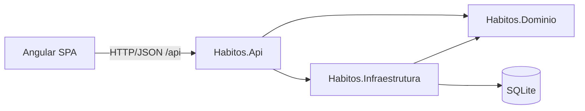

# Tecnologia

## Stack

| Camada | Tecnologia | Observação |
|---|---|---|
| Back-end | .NET 10 (LTS), ASP.NET Core Minimal API | |
| Persistência | EF Core 10 + SQLite | arquivo `habitos.db`, fora do controle de versão |
| Front-end | Angular (última versão estável) + Angular Material | versão fixada no `package.json` na tarefa 001/T0.3 |
| Testes back-end | xUnit, `WebApplicationFactory`, SQLite em memória, `FakeTimeProvider` | |
| Testes front-end | runner padrão do Angular CLI | |
| CI | GitHub Actions | build + testes em todo push e pull request |

## Arquitetura



**Regras de dependência**

- `Habitos.Dominio` não depende de nada (nem de EF Core). Contém entidades, objetos de valor e regras (validações, sequência, estatísticas).
- `Habitos.Infraestrutura` depende do Domínio. Contém `HabitosDbContext`, mapeamentos do EF e migrations.
- `Habitos.Api` depende dos dois. Contém endpoints, contratos (DTOs), tratamento de erros, `IRelogio` e configuração.
- Regras de negócio ficam no Domínio, nunca nos endpoints nem no front-end.

## Estrutura de pastas

```
/
├── backend/
│   ├── Habitos.slnx
│   ├── Directory.Build.props
│   ├── src/
│   │   ├── Habitos.Dominio/
│   │   ├── Habitos.Infraestrutura/
│   │   └── Habitos.Api/
│   └── tests/
│       ├── Habitos.Dominio.Testes/
│       └── Habitos.Api.Testes/
├── frontend/
│   └── src/app/
│       ├── nucleo/            ← serviços de API, modelos, interceptors
│       ├── compartilhado/     ← pipes e componentes reutilizáveis
│       └── funcionalidades/   ← uma pasta por tela (hoje, habitos, …)
├── docs/
└── .github/workflows/ci.yml
```

## Convenções

### Gerais

- **Tudo em português**: classes, métodos, variáveis, rotas da API, commits e interface.
- Identificadores **sem acento e sem cedilha**: `Habito`, `Marcacao`, `CalculadoraDeSequencia`, `descricao`.
- Nomes de framework e padrões técnicos continuam como são: `HabitosDbContext`, `Program`, `appsettings.json` e sufixos gerados pelo Angular CLI.
- Datas de negócio são `DateOnly` no back-end e `"AAAA-MM-DD"` no JSON. Instantes técnicos (auditoria) são `DateTime` em UTC.

### C# / .NET

- `Nullable` e `ImplicitUsings` habilitados; `TreatWarningsAsErrors` ligado (via `Directory.Build.props`).
- Namespaces com escopo de arquivo; `record` para DTOs e objetos de valor.
- Ids `Guid` gerados com `Guid.CreateVersion7()`.
- Nunca usar `DateTime.Now` ou `DateTime.UtcNow` diretamente. "Hoje" vem de `IRelogio` (baseado em `TimeProvider`) e entra no domínio como parâmetro.
- Validações e regras ficam no Domínio, que lança `ExcecaoDeValidacao` (campo + mensagem) ou `ExcecaoDeRegraDeNegocio`.
- Erros HTTP no formato Problem Details (RFC 9457):

  | Situação | Status |
  |---|---|
  | Dados inválidos | 400 (`ValidationProblemDetails`, com erros por campo) |
  | Recurso não encontrado | 404 |
  | Regra de negócio violada (ex.: marcar outro dia) | 422 |

- JSON em camelCase; enums serializados como texto (`"diasDaSemana"`).

### Angular

- Seguir os padrões do Angular CLI atual: componentes standalone, signals para estado, controle de fluxo `@if`/`@for` e formulários reativos tipados.
- Telas ficam em `funcionalidades/` e não fazem chamadas HTTP diretas: usam os serviços de `nucleo/api/`.
- O front-end **não decide regras de negócio** (nem calcula "hoje"): exibe o que a API devolve.
- Angular Material para componentes; layout responsivo a partir de 360px de largura.
- Em desenvolvimento, `proxy.conf.json` redireciona `/api` para a API, então não é preciso configurar CORS.

## Testes

- **Domínio (unitários):** toda regra de negócio. É onde fica a maioria dos testes.
- **API (integração):** endpoints de ponta a ponta com `WebApplicationFactory`, SQLite em memória e `FakeTimeProvider` para controlar "hoje".
- **Front-end (unitários):** pipes, lógica de componentes e serviços.
- Nome dos testes: `Metodo_Cenario_ResultadoEsperado`, ex.: `Marcar_DataDiferenteDeHoje_LancaExcecao`.
- Todo critério de aceite precisa de pelo menos um teste. Quando ajudar a rastrear, cite o critério num comentário (`// 001 CA 6.4`).
- Asserções com o `Assert` do xUnit; nada de bibliotecas extras no começo.

## Git e fluxo de trabalho

- A branch `main` fica sempre verde. Uma branch por spec: `spec/001-habitos-e-marcacao`.
- Commits pequenos, em português, no padrão Conventional Commits, citando a tarefa:
  - `feat(habitos): cria endpoint de cadastro (001/T3.3)`
  - `test(dominio): cobre alteração de frequência (001/T1.4)`
  - `docs(spec): ajusta critério 3.5 da spec 001`
- Um pull request por fase de tarefas (ou por spec), com a CI verde antes do merge.

## CI (GitHub Actions)

Em todo push e pull request:

- **backend:** `dotnet restore` → `dotnet build` → `dotnet test`
- **frontend:** `npm ci` → `npm test` (modo CI, sem watch) → `npm run build`

## Definição de pronto

- **Tarefa:** código + testes passando + checkbox marcado + spec atualizada se algo mudou.
- **Spec:** todos os critérios cobertos por teste ou roteiro manual, CI verde, README atualizado e status `Concluída`.
